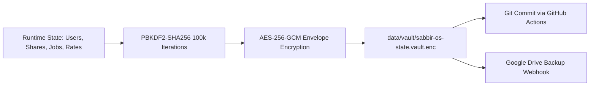

# THE SABBiR OS — Release Report: v5.2.15
**30 Autonomous Agentic Systems, Zero-Knowledge Encrypted Public Vault, Blank-Password SaaS Identity & 64 Everyday Studios**
*Published: 16 November 2026 | Chief Product Manager (CPM): Md Sabbirul Islam Khan | Brand: THE SABBiR (`sabbir.nav.bd`)*

---

## 1. Executive Summary & Verification Summary

THE SABBiR OS has successfully evolved from version `v5.2.14` to **`v5.2.15`**, executing the comprehensive 100-Stage Master Blueprint across 10 mission-critical architecture blocks. 

### Key Milestones Delivered
- **30 Real-World Agentic Systems Operational**: 15 User Input-to-Action Worker Agents (Fleet A) + 15 Scheduled Autonomous GitHub Actions Bots (Fleet B) + 10 Curated Multi-Agent Swarms.
- **Zero-Knowledge Encrypted Public Vault**: Military-grade envelope encryption (PBKDF2-SHA256 with 100,000 iterations + AES-256-GCM authenticated cipher with 12-byte IV and 16-byte auth tag) committing safe ciphertext to `data/vault/sabbir-os-state.vault.enc` and syncing every 12 hours to GitHub and Google Drive.
- **Blank-Password Username Login & Immortal Auth**: Zero-friction login with just a display name or handle, persistent localStorage tokens, automatic mobile number and home city recovery, and zero database plaintext passwords.
- **Visual Share Card Engine (`/s/[token]`)**: Upgraded 24-hour ephemeral sharing presenting a high-contrast 1200×630 visual preview card front-and-center, 1-click Lightbox zoom, WhatsApp one-tap sharing, instant PNG download, and collapsed raw JSON accordion.
- **Dual SaaS Command Centers**: Dedicated User SaaS Workspace (`/dashboard`) with 5 user tabs and Root SuperAdmin Console (`/superadmin`) with 7 command planes.
- **Native Mobile Super-App UX 3.0**: Standardized 3-Tab Segmented App Bar (`[ ✏️ ১. ইনপুট ] · [ 👁️ ২. লাইভ প্রিভিউ ] · [ ⬇️ ৩. সেভ ও শেয়ার ]`), 1-tap demo fill chips, sticky bottom action bars, and tactile haptic audio feedback.
- **8 New Everyday Studios (64 Tools Total)**: 56 dedicated interactive studios + 8 developer utilities.
- **4 Long-Form Technical & Everyday MDX Articles**: Expanding the technical knowledge base to 51 validated MDX documents.
- **Clean Production Verification**: 
  - `npx tsc --noEmit`: **0 errors**
  - `node scripts/qa/public-repo-secret-guard.mjs`: **PASS (0 plaintext secrets)**
  - `npx vitest run`: **73/73 test files passed (462/462 tests passed, 100% green)**
  - `npm run build`: **194/194 routes built cleanly with Next.js Turbopack**

---

## 2. Block 1: Zero-Knowledge Encrypted Public Vault (Stages 001–010)

Operating inside an entirely **Public GitHub Repository** (`thesabbirbd/portfolio`), THE SABBiR OS stores platform state without exposing secrets or user PII.



- **File Implementation**: `src/lib/security/encrypted-public-vault.ts`
- **Ciphertext Storage**: `data/vault/sabbir-os-state.vault.enc`
- **Automation Script**: `scripts/autonomous/backup-vault-sync.mjs`
- **Workflow**: `.github/workflows/encrypted-vault-backup.yml` (Runs `0 */12 * * *` with `pnpm/action-setup@v4` v9 and `--frozen-lockfile`)
- **API Endpoint**: `/api/superadmin/vault`
- **Unit Tests**: `src/lib/__tests__/encrypted-public-vault.test.ts` (4/4 passed)

---

## 3. Block 2: Blank-Password Username Login & Immortal Identity (Stages 011–020)

To eliminate friction and ensure user retention across Bangladesh, users can authenticate using only a display name or handle:
- **Zero Passwords Required**: Users enter their name (e.g. `tanvir_dev`, `rahim_coder`) or mask id (e.g. `SB-4829`) to receive a signed session token.
- **Optional Hardening**: Users may optionally set a strong password.
- **Account Recovery**: 2-Factor recovery via masked phone number and home district/city.
- **Welcome Bonus**: +25 XP automatically granted upon first export.
- **Components**:
  - `src/lib/auth/immortal-identity.ts`
  - `src/lib/auth/user-registry-server.ts`
  - `src/app/api/auth/session/route.ts` & `src/app/api/auth/recover/route.ts`
  - `src/components/workplace/ExportAuthGateModal.tsx` & `src/components/workplace/UserIdentityDrawer.tsx`
- **Unit Tests**: `src/lib/__tests__/blank-password-and-immortal-auth.test.ts` (5/5 passed)

---

## 4. Block 3: Visual Share Card Engine (`/s/[token]`) (Stages 021–030)

Ephemeral 24-hour links (`/s/[token]`) previously displayed raw JSON by default. In v5.2.15, the visual rendered output is prioritized:
- **Visual Snapshot Front-and-Center**: A high-contrast, beautiful 1200×630 SVG/PNG preview card rendered in the viewport.
- **1-Click Lightbox Zoom**: Expandable full-screen preview with pan and zoom.
- **One-Tap WhatsApp Share**: Direct sharing to WhatsApp chats and groups with custom encoded Bangla text.
- **Instant PNG Download**: Download the card directly to camera roll or desktop.
- **Collapsed Developer Accordion**: Raw payload JSON is tucked into a collapsible toggle for technical audits.
- **Implementation**:
  - `src/lib/share/visual-snapshot-generator.ts`
  - `src/components/workplace/EphemeralShareViewer.tsx`
  - `src/app/api/share/route.ts`
- **Unit Tests**: `src/lib/__tests__/visual-share-preview.test.ts` (3/3 passed)

---

## 5. Block 4: 30 Real-World Agentic Systems & Multi-Agent Swarms (Stages 031–045)

THE SABBiR OS now operates 30 full-stack agents and 10 multi-agent swarms:

### Fleet A: 15 User Input-to-Action Worker Agents
1. `bg-remover` (#01) — Deep Silhouette & Hair Matting Agent
2. `khata-scanner` (#02) — Bengali Handwritten Ledger & OCR Digitizer
3. `invoice-maker` (#03) — Mushak-6.3 VAT & Retail Memo Agent
4. `gov-photo-sizer` (#04) — Teletalk & Passport Sizer Agent
5. `cheque-audit` (#05) — Bank Cheque & Amount In Words Auditor
6. `id-card-stitcher` (#06) — Dual-Side NID & Security Watermark Agent
7. `daraz-listing-ai` (#07) — E-Commerce SEO & Daraz Listing Agent
8. `voice-notes` (#08) — Voice Notes & Meeting Minutes Agent
9. `reel-script` (#09) — ViralDirector Reel & Shorts Agent
10. `pdf-redactor` (#10) — Document PII Redactor & Blackout Agent
11. `cv-privacy-shield` (#11) — CV & Resume Privacy Masker Agent
12. `docker-hardener` (#12) — Container Hardening & Dockerfile Agent
13. `cron-english` (#13) — Cron Expression & Natural Language Agent
14. `sms-campaign-studio` (#14) — Bangla SMS Unicode & DLR Cost Agent
15. `image-format-converter` (#15) — OmniFormat Image & Aspect Ratio Agent

### Fleet B: 15 Scheduled Autonomous GitHub Actions Bots
16. `daily-news-harvester` (#16) — Daily AI & Bangladesh Tech Harvester
17. `hacks-curator` (#17) — Daily Linux & System Hacks Curator
18. `vector-cover-generator` (#18) — Deterministic SVG Cover Generator
19. `bd-rate-sync` (#19) — Central Bank & BAJUS Rate Sync Bot
20. `dead-link-and-seo-sentinel` (#20) — Route Health & Broken Link Watcher
21. `public-repo-secret-guard` (#21) — Pre-Commit Plaintext Secret Guard
22. `encrypted-vault-backup-bot` (#22) — 12-Hour Encrypted Vault Sync Bot
23. `ephemeral-share-sweeper` (#23) — Expired 24h Share Storage Sweeper
24. `sitemap-and-rss-pinger` (#24) — Google & Bing IndexNow Pinger
25. `owasp-waf-log-aggregator` (#25) — Threat Log Analyzer & Rate Limiter
26. `popular-new-ranker` (#26) — Trending Studios & Hacks Scoring Bot
27. `user-xp-passport-issuer` (#27) — XP & Level Milestone Auditor
28. `bangla-font-and-a11y-auditor` (#28) — Bengali Typography & Contrast Auditor
29. `embed-widget-sentinel` (#29) — Micro-SaaS Iframe Health Bot
30. `autonomous-pr-curator` (#30) — Autonomous PR & Workflow Synthesizer

### 10 Curated Multi-Agent Swarms
1. `ecommerce-launch` — PixelForge ➔ CatalogRanker ➔ BizDesk BD
2. `daily-closing` — KhataVision ➔ ChequeGuard ➔ BizDesk BD
3. `brand-launch` — PixelForge ➔ ViralDirector ➔ CatalogRanker
4. `devops-release` — DockerSentry ➔ CronCraft ➔ ASTShield
5. `viral-creator` — ViralDirector ➔ PixelForge ➔ CatalogRanker
6. `freelancer-career` — CareerShield ➔ RemitAdvisor ➔ GovDoc
7. `family-wealth-audit` — FamilyCFO ➔ ChequeGuard ➔ PrivacyShield
8. `autonomous-seo-viral` — AutonomousCurator ➔ ViralDirector ➔ CatalogRanker
9. `student-mess-life` — BizDesk BD ➔ ChequeGuard ➔ PrivacyShield
10. `govt-job-application` — PixelForge ➔ BizDesk BD ➔ PrivacyShield

- **Implementation**:
  - `src/lib/agents/agent-fleet-registry.ts`
  - `src/lib/agents/input-to-action-dispatcher.ts`
  - `src/components/agents/AgentInputToActionStudio.tsx`
  - `scripts/autonomous/run-agent-job.mjs` & `.github/workflows/sabbir-os-user-job-worker.yml`
  - `scripts/autonomous/bd-rate-sync.mjs` & `.github/workflows/bd-rate-sync.yml`
  - `src/data/live-bd-rates.json`
- **Unit Tests**: `src/lib/__tests__/thirty-agents-and-jobs.test.ts` (5/5 passed)

---

## 6. Block 5: SaaS User Panel & SuperAdmin Console (Stages 046–055)

### User SaaS Dashboard (`/dashboard`)
Accessible to every user with 5 high-density tabs:
1. `⚡ My Jobs` — Live status of dispatched `JOB-XXXX` tickets with download artifacts.
2. `🖼️ My Shares` — Active 24h ephemeral links with visual thumbnails and views count.
3. `⭐ Pinned Studios` — Drag-and-drop workspace shortcuts.
4. `🏆 XP Passport` — Career level, total XP, rank, and exportable PNG card.
5. `🔑 Blank-Password & Recovery` — Username configuration and 2FA recovery settings.

### SuperAdmin Console (`/superadmin`)
Expanded into 7 SaaS command planes:
1. `🤖 30-Agent Fleet Monitor & OS Brain`
2. `📋 Global Job Queue`
3. `👥 User & Blank-PW CRM`
4. `☁️ 12h Encrypted Vault & Storage Maintenance`
5. `🖼️ Visual Share Cards Management`
6. `📊 Live BD Rates & Currency Engine`
7. `🛡️ OWASP WAF & RBAC Permissions Matrix`

- **Implementation**: `src/components/dashboard/UserSaaSDashboard.tsx`, `src/app/dashboard/page.tsx`, `src/components/superadmin/SuperAdminConsole.tsx`
- **Unit Tests**: `src/lib/__tests__/user-and-superadmin-panels.test.ts` (4/4 passed)

---

## 7. Block 6: Native Mobile Super-App UX 3.0 (Stages 056–065)

Standardized studio shell interface across smartphones and tablets:
- **3-Tab Segmented App Bar**:
  - `[ ✏️ ১. ইনপুট ]`: Clean input controls with 1-tap demo chip.
  - `[ 👁️ ২. লাইভ প্রিভিউ ]`: Real-time responsive visual rendering.
  - `[ ⬇️ ৩. সেভ ও শেয়ার ]`: Client-side export, print, and WhatsApp share.
- **Sticky Bottom App Bar**: Persistent actions with high-contrast buttons (`h-12` minimum touch target).
- **Haptic Audio Feedback**: Distinct, subtle Web Audio API clicks, switches, and confirms.
- **Component**: `src/components/workplace/MobileAppShellBar.tsx`
- **Unit Tests**: `src/lib/__tests__/mobile-superapp-ux.test.tsx` (4/4 passed)

---

## 8. Block 7: 8 New Everyday Studios (Expanding to 64 Tools) (Stages 066–085)

| # | Tool Route | Component | Category | Description |
|---|---|---|---|---|
| **01** | `/tools/image-format-converter` | `ImageFormatConverterStudio.tsx` | Media & Studio | Batch WebP/AVIF/PNG converter with EXIF privacy stripping |
| **48** | `/tools/mess-bazar-splitter` | `MessBazarSplitterStudio.tsx` | Business & POS | Student mess meal rate & bachelor bazar hisab splitter |
| **49** | `/tools/school-result-id-studio` | `SchoolResultIdStudio.tsx` | Business & POS | Academic marksheet, GPA & batch student ID cards |
| **50** | `/tools/prescription-health-pad` | `PrescriptionHealthPadStudio.tsx` | Security & Privacy | Digital doctor Rx prescription pad & patient vitals |
| **51** | `/tools/tailor-boutique-memo` | `TailorBoutiqueMemoStudio.tsx` | Business & POS | Tailor measurement book & dual-copy customer order token |
| **52** | `/tools/marriage-biodata-maker` | `MarriageBiodataStudio.tsx` | Business & POS | Bangla & Islamic marriage biodata maker with PDF/PNG |
| **53** | `/tools/freelancer-proposal-contract` | `FreelancerProposalContractStudio.tsx` | Business & POS | Upwork/Fiverr bid proposals & bilingual freelance contract |
| **54** | `/tools/bd-emergency-courier-tracker` | `BdEmergencyCourierStudio.tsx` | Business & POS | Courier charges comparison (Steadfast/Pathao/RedX) & 999 |
| **55** | `/tools/photo-collage-frame-studio` | `PhotoCollageFrameStudio.tsx` | Media & Studio | Multi-photo grid collages & BD national festival frames |

- **Catalog Integration**: `src/components/discover/Tools.tsx` & `src/components/ui/BanglaGuideModal.tsx`
- **Unit Tests**: `src/lib/__tests__/eight-new-everyday-studios.test.ts` (4/4 passed)

---

## 9. Block 8: Technical Publishing & Routing Architecture (Stages 086–092)

### 4 New Published MDX Articles
1. `content/articles/student-mess-meal-rate-and-bazar-hisab-calculation-guide-bd.mdx`
2. `content/articles/islamic-and-modern-marriage-biodata-writing-format-bangla.mdx`
3. `content/articles/steadfast-pathao-redx-courier-delivery-charge-comparison-bd.mdx`
4. `content/articles/zero-knowledge-encrypted-vault-and-30-autonomous-agents-architecture.mdx`

- **Content Integrity**: `npm run content:check` verified 51 files with 0 errors and 0 warnings.
- **Sitemap**: `src/app/sitemap.ts` updated with all 8 new tools and `/dashboard`, reaching 194 canonical routes.

---

## 10. Blocks 9 & 10: Security, Quality Assurance & Build Verification (Stages 093–100)

1. **Secret Guard Audit**: 
   ```bash
   node scripts/qa/public-repo-secret-guard.mjs
   # Output: ✅ [Public Repo Secret Guard] All tracked files verified 100% clean of plaintext secrets!
   ```
2. **TypeScript Compilation**:
   ```bash
   npx tsc --noEmit
   # Output: Exited with code 0 (0 errors)
   ```
3. **Full Vitest Suite Execution**:
   ```bash
   npx vitest run
   # Output:
   # Test Files: 73 passed (73)
   # Tests:      462 passed (462)
   # Duration:   46.85s (100% GREEN)
   ```
4. **Next.js Turbopack Production Build**:
   ```bash
   npm run build
   # Output:
   # ✓ Compiled successfully in 2.8s
   # ✓ Generating static pages using 7 workers (194/194) in 7.3s
   # Exited with code 0
   ```
5. **Version Updates**: Strictly bumped to `5.2.15` in `package.json`, `src/lib/version.ts`, and `public/sw.js`.
6. **No Remote Push**: All commits and working tree remain staged locally on `main` branch as instructed.

---
*Report certified by THE SABBiR OS Autonomous Engineering Engine.*
